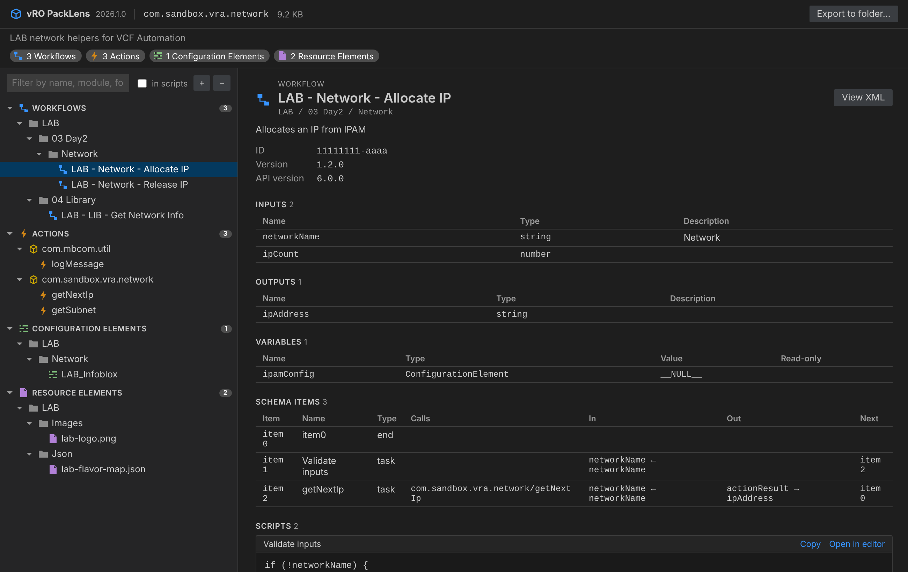

# vRO PackLens

See inside any vRO `.package` file - right in VS Code.



Click any `.package` file in the VS Code Explorer and it opens as a browsable tree:

- **Workflows** – in their Orchestrator folder structure; inputs, outputs, variables, schema items and every scriptable task
- **Actions** – grouped by module; inputs, return type, script
- **Configuration Elements** – folders and attributes (SecureStrings are masked)
- **Resource Elements** – metadata, text preview, *Save as…*
- **Policy Templates** and anything else in the package

Extras: filter by name/module/folder (optionally inside scripts), open any script or XML in a real editor tab, and **Export to folder…** to unpack the whole package as `.js` / `.xml` files you can grep or diff.

Works with packages from vRealize Orchestrator 7.x, Aria Automation Orchestrator 8.x and VCF Operations Orchestrator 9.x. Read-only – the package is never modified.

## Install
Extensions view → `…` menu → **Install from VSIX…** → pick `vro-packlens-<version>.vsix`.

If another extension already claims `.package`, right-click the file → **Open with vRO PackLens** (or *Open With…* → vRO PackLens → *Configure default*).

## Build from source
```
npm install
npx @vscode/vsce package
```
A sample package for testing is in `samples/`.

## Related
[vRO Peekage](https://github.com/imtrinity94/vRO-Peekage) is the separate web app for viewing packages in a browser.
